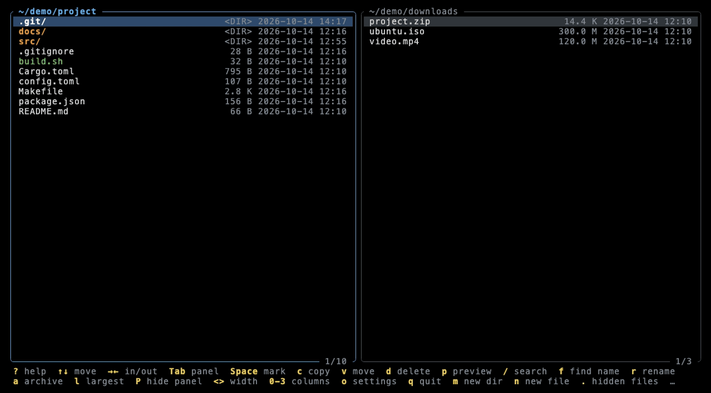
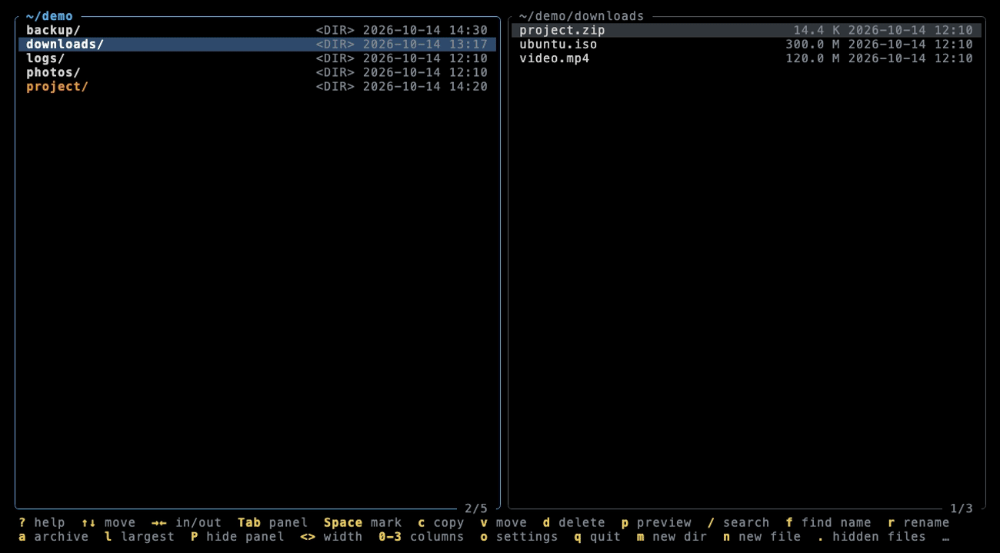
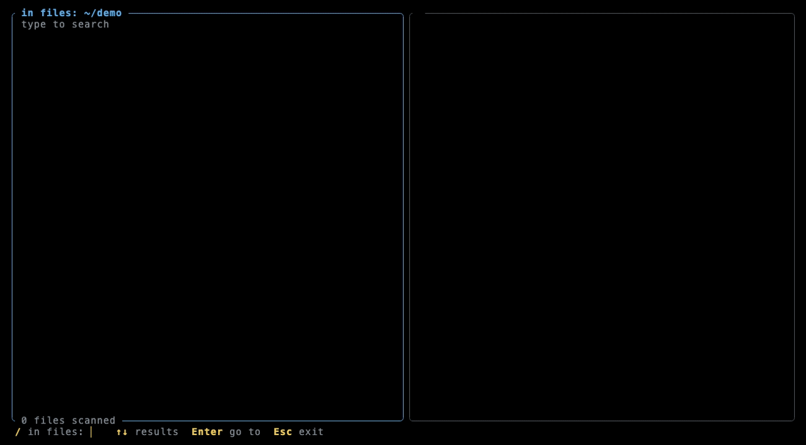
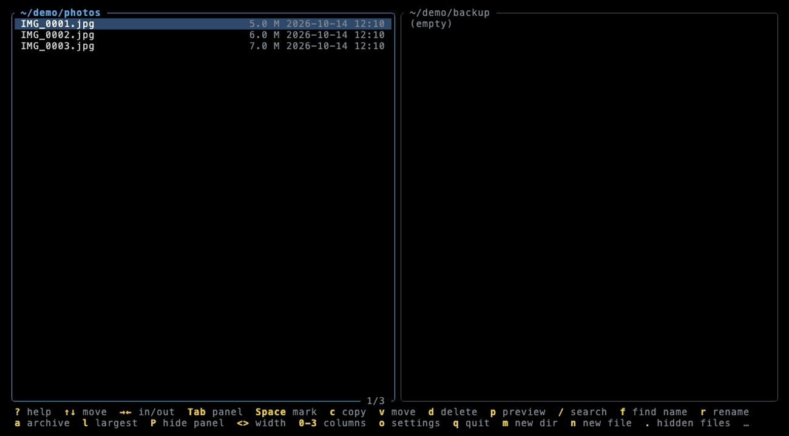
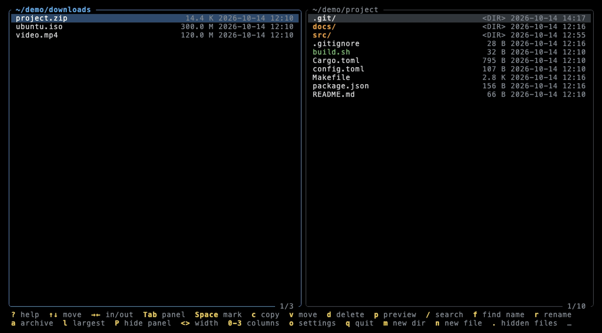
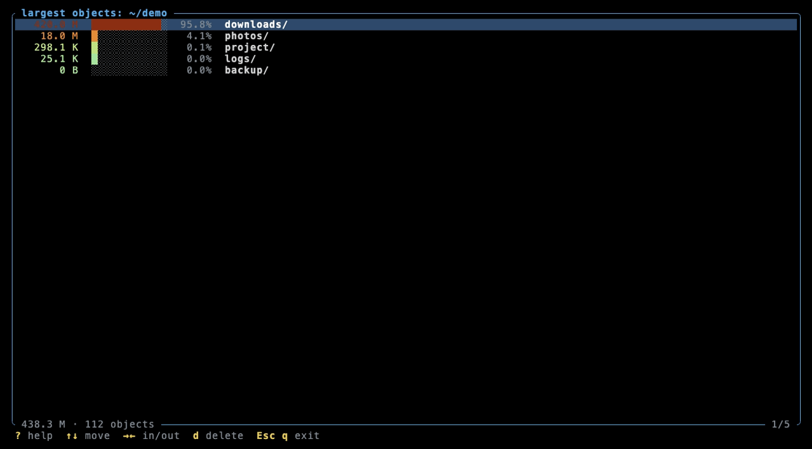
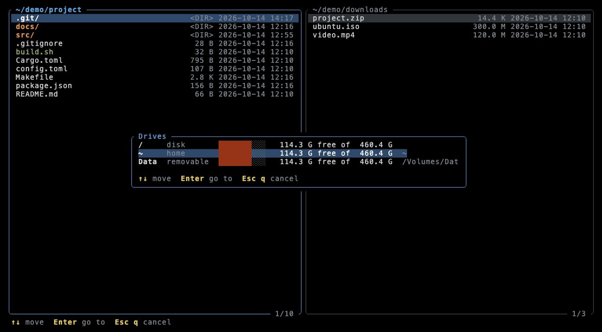

<p align="center">
  
</p>

<h1 align="center">Janus</h1>

**English** · [Русский](README.ru.md)

A fast two-panel file manager for the terminal, written in Rust. Named after
Janus, the two-faced Roman god who looks both ways at once — like its two panels. Two panels,
a preview with syntax highlighting, a built-in editor, recursive search,
archives, a "largest objects" view, git status and a drive picker — all from
the keyboard, with every long operation running in the background.


## Contents

- [Features at a glance](#features-at-a-glance)
- [Installation](#installation)
- [Panels and navigation](#panels-and-navigation)
- [Preview](#preview)
- [Editor](#editor)
- [Search](#search)
- [Copy, move, delete](#copy-move-delete)
- [Rename](#rename)
- [Archives](#archives)
- [Largest objects](#largest-objects)
- [Drives and volumes](#drives-and-volumes)
- [Help, hints and settings](#help-hints-and-settings)
- [Themes](#themes)
- [Command line](#command-line)
- [Keyboard reference](#keyboard-reference)
- [Mascot](#mascot)

## Features at a glance

- Two panels, 0–3 columns per panel, adjustable split, one panel can be hidden.
- Colors by type: directories, executables, symlinks, broken links; files and
  directories with uncommitted git changes are orange.
- Preview in the second panel that follows the cursor: syntax highlighting for
  30+ formats, logs, directory info, hex dump for binaries, archive listing.
- Built-in editor with smart indentation (`.editorconfig`, auto-detection,
  language defaults).
- Background search by content and by name over the whole subtree, results
  shown live in the preview.
- Copy / move with progress and a conflict dialog; delete to trash or permanently;
  rename in place.
- Archives open like directories (zip, tar, gz, tar.gz, tar.zst; rar/7z through
  external tools) and can be created from marked files.
- "Largest objects" mode: recursive sizes, share bars and a heat-map gradient.
- Drive picker: drive letters on Windows, mount points on macOS and Linux.
- Context-aware hint line, full help window, settings window.
- English and Russian interface, five color themes.
- When you quit, the shell changes into the directory of the active panel.

## Installation

You need a [Rust toolchain](https://rustup.rs) (edition 2024, Rust 1.88+).

**macOS / Linux**

```bash
git clone https://github.com/Pastor/janus.git
```

```bash
cd janus && make install
```

`make install` builds the release binary into `~/.cargo/bin/janus` and adds the
`f` shell function to `~/.zshrc`, `~/.bashrc` or fish's `conf.d`. Open a new
terminal and run `f`: after you quit, the shell is left in the directory of the
active panel (for an open archive — in the directory containing it).
`make uninstall` removes both.

If you used it under its former name `fmgr`, `make install` removes the old
binary and shell hook, and your settings are copied from `~/.config/fmgr`
on the first start.

**Windows**

```bash
cargo install --path . --locked
```

Then run `janus` in Windows Terminal or any terminal with VT support. Use `g` to
switch between drives. The `f` shell function is not available for PowerShell
or cmd yet.

## Panels and navigation



There are always two panels and exactly one of them is active (highlighted
border). The path is shown in the top border, the position counter and the
number/size of marked files — in the bottom one.

- `↑` `↓` `PgUp` `PgDn` `Home` `End` move the cursor.
- `→` / `Enter` enter a directory or an archive, `←` goes up and puts the cursor
  on the directory you came from. `←` at the root opens the drive picker.
- `Tab` switches panels, `<` / `>` change the split, `P` hides or shows the
  second panel.
- `1` `2` `3` — number of columns. In multi-column mode files flow down the
  columns like `ls`; `Shift+←` / `Shift+→` jump to the neighbouring column.
  Size and date are shown only with one column; `0` gives one column with
  names only.
- `.` toggles hidden files (the default is set in the settings).

Directories come first, in bold, with a trailing `/`. Executables are green,
symbolic links blue, broken links red and struck through. With git installed, files and
subdirectories with uncommitted changes (modified, staged, deleted, untracked)
are orange; outside a working tree, repositories that contain such changes are
highlighted instead. The status is computed in the background on every reread.

If a command key is pressed in a non-Latin keyboard layout, Janus does not
silently ignore it — the status line says that the layout is wrong.

## Preview



`p` opens a preview in the second panel. It follows the cursor of the file
panel; `Enter` on a file opens the preview and moves focus into it.

| What is under the cursor | What the preview shows |
|---|---|
| Text file | Syntax highlighting, line numbers for source code |
| Directory | Path, number of files and subdirectories, total size (counted in the background), permissions, owner, dates, the largest entries |
| Binary file | Type, size, permissions, dates, hex dump of the beginning |
| Archive | List of entries |

In the preview: `Tab` moves focus between the panels, `↑↓ PgUp PgDn Home End`
scroll, `w` toggles soft wrap (`←` `→` shift the text when wrap is off),
`/` searches the text as you type (the match is centered, `←` `→` go to the
previous / next one with a `3/17` counter), `e` opens the editor, `p` / `Esc` close.


**Highlighting** is done by an own line-based lexer:

| Category | Formats |
|---|---|
| Languages | Rust, C/C++, Go, Java, Kotlin, Python, JS/TS, Lua, Ruby, Shell, Swift, C#, PHP |
| Markup | Markdown, HTML, XML, CSS |
| Data and config | JSON, YAML, TOML, INI, `.properties`, `.env`, `.editorconfig` |
| Other | SQL, Dockerfile, Makefile, `.gitignore` / `.dockerignore` / `*ignore`, diff/patch |
| Logs | `*.log` and files that look like a log |

The format is detected by name and extension, or by the shebang and first lines.
In logs, `ERROR`/`FATAL` are red, `WARN` yellow, `DEBUG`/`TRACE` dimmed;
timestamps, IP addresses, URLs, numbers, quoted strings and stack traces are
highlighted too.


## Editor

`e` in the preview turns it into an editor.


- Arrows, `Home` `End` `PgUp` `PgDn`, `Ctrl+Home` / `Ctrl+End`; `Home` goes to the
  first non-blank character, pressed again — to the line start.
- `Tab` / `Shift+Tab` indent and dedent, `Enter` keeps the indentation and
  increases it after `{`, `(`, `[` and `:` in Python.
- The indent size comes from `.editorconfig`, otherwise it is detected from the
  file, otherwise the language default is used (4 spaces for Rust, Python, C…;
  2 for JS/TS, JSON, YAML…; tabs for Go and Makefile).
- `Ctrl+S` saves (with confirmation), `Esc` asks to save / discard / keep
  editing when there are changes.

## Search



- `/` — search by **content** across the whole subtree of the current directory.
- `f` — search by **name** (substring).

Search runs in the background as you type. Binary files are skipped, hidden
files follow the panel setting. Case is respected only if the query contains
uppercase letters (the same rule applies to all searches). The second panel
shows the found file with the match highlighted and centered; `↑` `↓` go through
the matches (across files), `Enter` jumps to the file in the panel, `Esc` leaves
the search.


## Copy, move, delete



- `Space` marks a file and moves the cursor down; the bottom border shows the
  number and total size of the marked files.
- `c` copies and `v` moves the marked files (or the one under the cursor) into the
  directory of the other panel. A progress dialog is shown; `Esc` cancels.
- On a name conflict you choose: `r` replace, `s` skip, `R` replace all,
  `S` skip all, `Esc` cancel.
- `d` deletes to trash, `D` deletes permanently. Both ask for confirmation —
  press the same key again. In the settings you can make `d` delete permanently too.

| Conflict | Permanent delete |
|---|---|
|  |  |

## Rename


`r` (or `F2`) renames the file or directory under the cursor right in the panel.

- The cursor starts before the extension: `report|.pdf` — usually you change the
  name, not the type. For directories and names like `.gitignore` it starts at the end.
- `←` `→` `Home` `End` move inside the name, `Backspace` / `Delete` erase,
  any letters (Cyrillic included) are typed as text. `Enter` renames, `Esc` cancels.
- After renaming, the cursor stays on the item under its new name, and the other
  panel is refreshed if it shows the same directory.
- An existing name is never overwritten: the status line says "already exists".
  Changing only the case (`readme.md` → `README.md`) works on case-insensitive
  file systems too. Names with `/` (and `\ : * ? " < > |` on Windows) are rejected.
- Archives are read-only, so renaming inside an open archive is not allowed.


## New directory and file

`m` creates a directory, `n` creates an empty file in the directory of the active panel.

- The dialog shows where the item will be created and an empty input line; editing
  keys are the same as in rename. `Enter` creates, `Esc` cancels.
- The cursor moves to the new item.
- An existing name is never overwritten; invalid names are rejected the same way
  as in rename. Inside an open archive creating is not allowed.

## Archives



- `Enter` on an archive extracts it into a temporary directory in the background
  and the panel works inside it like in a normal folder. The title shows
  `archive.zip/…`. The temporary directory is removed when you leave the archive
  and on exit.
- Formats: zip, tar, gz, tar.gz/tgz, tar.zst. RAR and 7z are opened through
  `unrar`, `7z`/`7zz` or `bsdtar` if one of them is installed.
- Archives are read-only: copying into them and editing their files is blocked,
  copying out of them works.
- `a` creates an archive from the marked files (or the item under the cursor) in
  the current directory: `←` `→` choose the format (zip, tar, tar.gz, tar.zst),
  type the name, `Enter` creates.


## Largest objects



`l` opens a full-screen view of the current directory: sizes are counted
recursively in the background, entries are sorted by size with a share bar,
a percentage and a color gradient. `→` / `Enter` go into a directory, `←` goes up,
`d` / `D` delete the object under the cursor (sizes of the parents are recalculated
without a rescan). `Esc` returns to the panels and opens the current directory
in the active one.


## Drives and volumes



`g` (or `←` at the root of a drive) opens the drive picker for the active panel.

- **Windows:** all drive letters with type (disk, removable, network, CD/DVD),
  volume label, a fill bar and free space. Press the drive letter to jump to it
  right away. No "insert a disk" system popups for empty card readers; network
  drives are not queried for free space so a disconnected share can't freeze the window.
- **macOS:** `/`, home directory and everything mounted in `/Volumes`.
- **Linux:** `/`, home directory and mounted block devices (USB sticks in
  `/media`, `/run/media`, `/mnt`, extra partitions), without `/boot` and snaps.

The cursor starts on the drive that contains the current directory.
`↑` `↓` choose, `Enter` / `→` go, `Esc` closes.


## Help, hints and settings

The bottom line shows only keys that will do something right now (for example,
`c` / `v` appear only when there is somewhere to copy). If they don't fit,
hints take two lines; whatever still doesn't fit becomes `…`.

`?` opens the full help with all keys grouped by mode, `o` opens the settings.

| Help | Settings |
|---|---|
|  |  |

Settings are applied immediately; `Enter` saves, `Esc` reverts:

- language: English / Русский;
- theme: Dark, Light, Gruvbox, Solarized, Nord;
- soft wrap in the preview;
- hidden files;
- default indent size;
- whether `d` moves to trash or deletes permanently.

`-t` and `-l` on the command line change the theme and language only for the
current run; they are not written to the config.

Settings live in `~/.config/janus/config.toml` (on all platforms). The session is
saved there too: panel split, columns, hidden panel and the last directory of
the right panel.

## Themes

Dark is the default. The theme can be changed in the settings or with `-t`.

| Light | Gruvbox |
|---|---|
|  |  |
| **Solarized** | **Nord** |
|  |  |

Colors adapt to the terminal: truecolor, 256 colors or 16 colors.

## Command line

```
janus [OPTIONS] [LEFT] [RIGHT]
```

| Option | Meaning |
|---|---|
| `LEFT`, `RIGHT` | Directories for the panels. Without them the left panel opens in the current directory and the right one where it was last time |
| `-t`, `--theme` | `dark`, `light`, `gruvbox`, `solarized`, `nord` — for this run only |
| `-l`, `--lang` | `en`, `ru` — for this run only |
| `--cwd-file FILE` | On exit, write the directory of the active panel into `FILE` |
| `--shell-init SHELL` | Print the `f` function for `zsh`, `bash` or `fish` |

Manual shell integration (what `make install` does):

```bash
eval "$(janus --shell-init zsh)"
```

## Keyboard reference

`Ctrl+C` always quits. `q` quits from the file list, cancels a running operation,
and acts as `Esc` in dialogs, help, settings, the preview and modes; in text
input it is just a letter.

**Panels**

| Key | Action |
|---|---|
| `↑↓ PgUp PgDn Home End` | Move the cursor |
| `→` `Enter` | Enter a directory or an archive; open a file in the preview |
| `←` | Go up; from an archive root — back to the archive; at the root — drives |
| `Tab` | Switch panel |
| `<` `>` | Narrow / widen the active panel |
| `P` | Hide / show the second panel |
| `0` `1` `2` `3` | Columns (`0` — names only) |
| `Shift+←→` | Neighbouring column |
| `.` | Hidden files |
| `g` | Drive picker |

**Files**

| Key | Action |
|---|---|
| `Space` | Mark |
| `c` / `v` | Copy / move to the other panel |
| `r` `F2` | Rename |
| `m` / `n` | New directory / new empty file |
| `d` / `D` | Delete to trash / permanently |
| `a` | Create an archive |
| `p` | Preview |
| `/` / `f` | Search by content / by name |
| `l` | Largest objects |
| `o` / `?` | Settings / help |

**Preview:** `Tab` focus, `↑↓ PgUp PgDn` scroll, `←→` shift, `w` wrap, `/` search,
`e` edit, `Esc` close.
**Editor:** `Ctrl+S` save, `Esc` close, `Tab` / `Shift+Tab` indent,
`Home`, `Ctrl+Home` / `Ctrl+End`.

## Mascot


Janus's mascot is a little owl whose facial disc is made of two "panels": the
**right eye is open** — that's the active panel; the **left eye is asleep** while
copying, search or size counting runs in the background. It sees everything,
even when half of it is asleep.

SVG and PNG versions (including favicon sizes) and the usage guide live in
[docs/mascot](docs/mascot/README.md). Distributed under the project's MIT license.

## License

[MIT](LICENSE)
