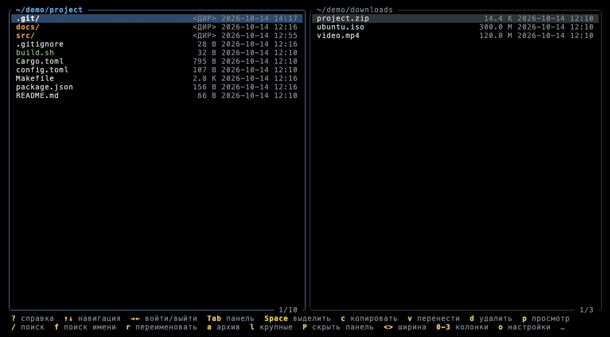
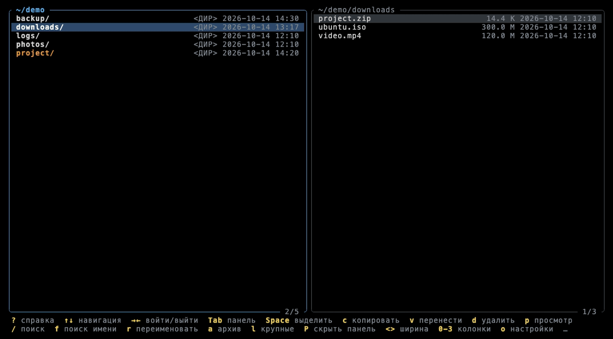
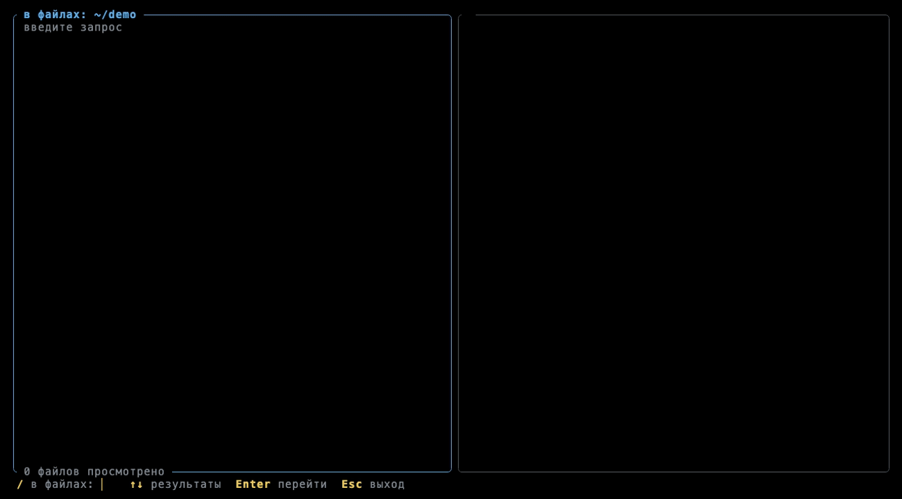
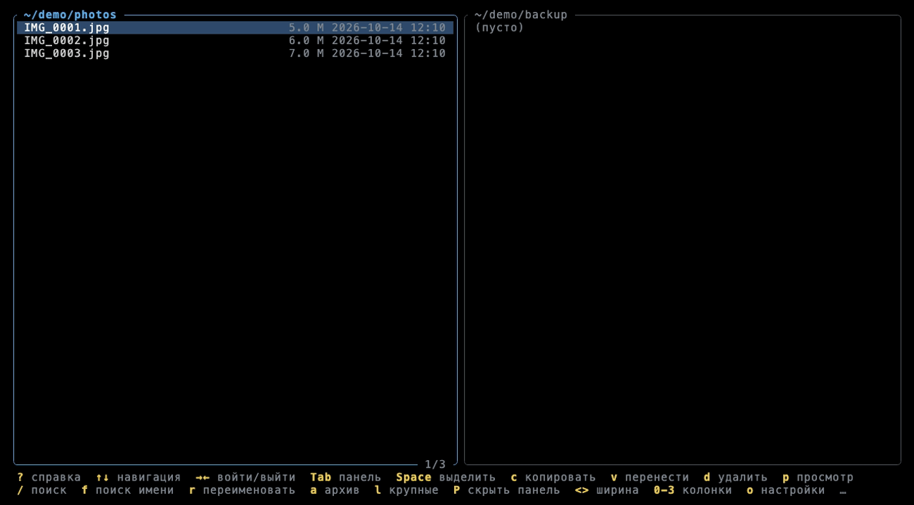
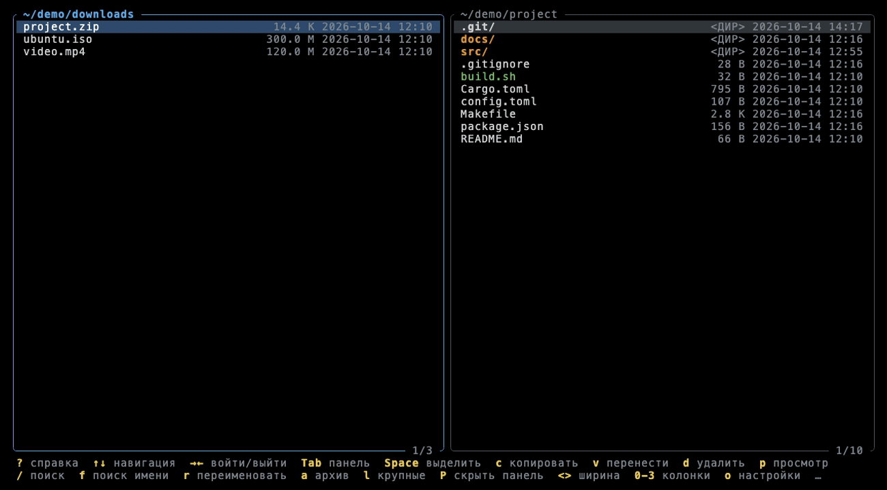
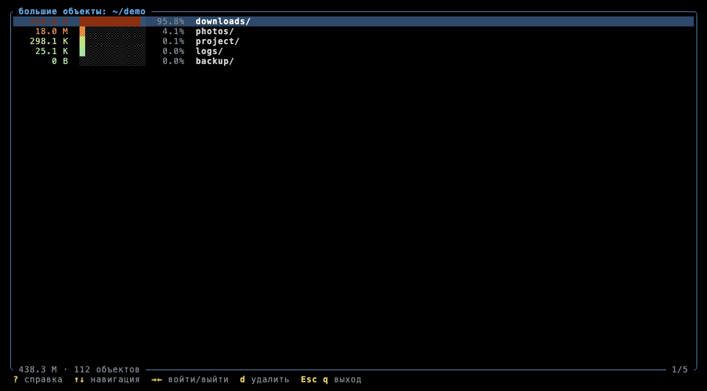
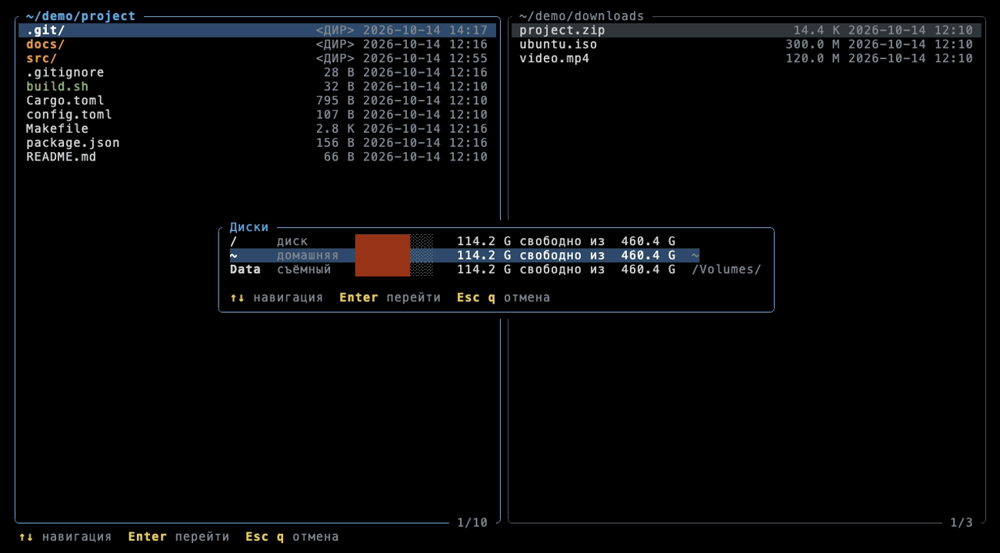

<p align="center">
  
</p>

<h1 align="center">Janus</h1>

[English](README.md) · **Русский**

Быстрый двухпанельный файловый менеджер для терминала на Rust. Назван в честь
Януса — двуликого римского бога, который смотрит сразу в обе стороны, как и его
две панели. Две панели,
предпросмотр с подсветкой синтаксиса, встроенный редактор, рекурсивный поиск,
архивы, режим «большие объекты», статус git и выбор диска — всё с клавиатуры,
а долгие операции идут в фоне и не блокируют интерфейс.


## Содержание

- [Коротко о возможностях](#коротко-о-возможностях)
- [Установка](#установка)
- [Панели и навигация](#панели-и-навигация)
- [Предпросмотр](#предпросмотр)
- [Редактор](#редактор)
- [Поиск](#поиск)
- [Копирование, перенос, удаление](#копирование-перенос-удаление)
- [Переименование](#переименование)
- [Архивы](#архивы)
- [Большие объекты](#большие-объекты)
- [Диски и тома](#диски-и-тома)
- [Справка, подсказки и настройки](#справка-подсказки-и-настройки)
- [Темы](#темы)
- [Командная строка](#командная-строка)
- [Все клавиши](#все-клавиши)
- [Маскот](#маскот)

## Коротко о возможностях

- Две панели, от 0 до 3 колонок в каждой, настраиваемая ширина, вторую панель
  можно скрыть.
- Цвета по типу: директории, исполняемые файлы, ссылки, битые ссылки. Файлы и
  директории с незакоммиченными изменениями git — оранжевые.
- Предпросмотр во второй панели следует за курсором: подсветка 30+ форматов,
  логи, сведения о директории, hex-дамп бинарных файлов, содержимое архива.
- Встроенный редактор с умными отступами (`.editorconfig`, автоопределение,
  умолчания по языку).
- Фоновый поиск по содержимому и по имени во всём поддереве, результат сразу
  виден в предпросмотре.
- Копирование и перенос с прогрессом и диалогом конфликтов, удаление в корзину
  или безвозвратно, переименование на месте.
- Архивы открываются как директории (zip, tar, gz, tar.gz, tar.zst; rar и 7z —
  через внешние утилиты) и создаются из выделенных файлов.
- Режим «большие объекты»: рекурсивные размеры, полоски доли и цветовой градиент.
- Выбор диска: буквы дисков в Windows, точки монтирования в macOS и Linux.
- Строка подсказок по контексту, окно справки, окно настроек.
- Интерфейс на английском и русском, пять цветовых тем.
- После выхода оболочка переходит в директорию активной панели.

## Установка

Нужен [Rust](https://rustup.rs) (edition 2024, Rust 1.88+).

**macOS / Linux**

```bash
git clone https://github.com/Pastor/janus.git
```

```bash
cd janus && make install
```

`make install` ставит бинарник в `~/.cargo/bin/janus` и подключает функцию
оболочки `f` в `~/.zshrc`, `~/.bashrc` или `conf.d` fish. Откройте новый терминал
и запускайте `f`: после выхода оболочка окажется в директории активной панели
(из открытого архива — там, где лежит архив). `make uninstall` убирает и то и другое.

Если программа стояла под прежним именем `fmgr`, `make install` уберёт старый
бинарник и подключение функции, а настройки при первом запуске скопируются
из `~/.config/fmgr`.

**Windows**

```bash
cargo install --path . --locked
```

Запускайте `janus` в Windows Terminal или любом терминале с поддержкой VT.
Диски переключаются клавишей `g`. Функции `f` для PowerShell и cmd пока нет.

## Панели и навигация



Панелей всегда две, активна ровно одна — её видно по рамке. Путь показан в верхней
рамке, счётчик позиции и число/размер выделенных файлов — в нижней.

- `↑` `↓` `PgUp` `PgDn` `Home` `End` — перемещение курсора.
- `→` / `Enter` — войти в директорию или архив, `←` — на уровень выше, курсор
  встаёт на директорию, из которой вышли. `←` в корне открывает выбор диска.
- `Tab` — переключить панель, `<` / `>` — сузить / расширить активную,
  `P` — скрыть / показать вторую.
- `1` `2` `3` — число колонок. При нескольких колонках список перетекает по
  колонкам, как в `ls`; `Shift+←` / `Shift+→` — соседняя колонка. Размер и дата
  видны только в режиме одной колонки; `0` — одна колонка только с именами.
- `.` — показать / скрыть скрытые файлы (умолчание задаётся в настройках).

Директории идут первыми, жирным и с `/` в конце. Исполняемые файлы зелёные,
символические ссылки синие, битые ссылки красные и зачёркнутые. Если установлен
git, файлы и поддиректории с незакоммиченными изменениями (изменённые, в индексе,
удалённые, неотслеживаемые) — оранжевые; вне рабочего дерева подсвечиваются
репозитории, в которых такие изменения есть. Статус считается в фоне при каждом
перечитывании директории.

Если команду нажали в кириллической раскладке, Janus не молчит: в строке
состояния появляется сообщение, что раскладка не та.

## Предпросмотр



`p` открывает предпросмотр во второй панели. Он следует за курсором файловой
панели; `Enter` на файле открывает предпросмотр и переводит в него фокус.

| Что под курсором | Что показывает предпросмотр |
|---|---|
| Текстовый файл | Подсветку синтаксиса, номера строк для исходников |
| Директория | Путь, число файлов и поддиректорий, суммарный размер (в фоне), права, владельца, даты, крупнейшие элементы |
| Бинарный файл | Тип, размер, права, даты, hex-дамп начала файла |
| Архив | Список содержимого |

В предпросмотре: `Tab` переключает фокус между панелями, `↑↓ PgUp PgDn Home End`
прокручивают, `w` включает и выключает перенос строк (без переноса `←` `→`
сдвигают текст), `/` ищет по тексту по мере набора (совпадение по центру экрана,
`←` `→` — предыдущее / следующее, счётчик `3/17`), `e` открывает редактор,
`p` / `Esc` закрывают.


**Подсветка** — собственный построчный лексер:

| Категория | Форматы |
|---|---|
| Языки | Rust, C/C++, Go, Java, Kotlin, Python, JS/TS, Lua, Ruby, Shell, Swift, C#, PHP |
| Разметка | Markdown, HTML, XML, CSS |
| Данные и настройки | JSON, YAML, TOML, INI, `.properties`, `.env`, `.editorconfig` |
| Прочее | SQL, Dockerfile, Makefile, `.gitignore` / `.dockerignore` / `*ignore`, diff/patch |
| Логи | `*.log` и файлы, похожие на лог по содержимому |

Формат определяется по имени и расширению, а если их нет — по shebang и первым
строкам. В логах `ERROR`/`FATAL` красные, `WARN` жёлтые, `DEBUG`/`TRACE`
приглушены; подсвечиваются также временные метки, IP-адреса, URL, числа,
строки в кавычках и stack trace.


## Редактор

`e` в предпросмотре превращает его в редактор.


- Стрелки, `Home` `End` `PgUp` `PgDn`, `Ctrl+Home` / `Ctrl+End`; `Home` ведёт
  к первому непробельному символу, повторное нажатие — в начало строки.
- `Tab` / `Shift+Tab` — отступ и его снятие; `Enter` сохраняет отступ строки и
  увеличивает его после `{`, `(`, `[` и `:` в Python.
- Размер отступа берётся из `.editorconfig`, иначе определяется по файлу, иначе —
  по языку (4 пробела для Rust, Python, C…; 2 для JS/TS, JSON, YAML…; табуляция
  для Go и Makefile).
- `Ctrl+S` сохраняет (с подтверждением), `Esc` при изменениях спрашивает:
  сохранить / не сохранять / продолжить правку.

## Поиск



- `/` — поиск по **содержимому** во всём поддереве текущей директории.
- `f` — поиск по **имени** (подстрока).

Поиск идёт в фоне по мере набора. Бинарные файлы пропускаются, скрытые — по той
же настройке, что и в панели. Регистр учитывается, только если в запросе есть
заглавные буквы (это правило общее для всех поисков). Вторая панель показывает
найденный файл, совпадение подсвечено и стоит по центру; `↑` `↓` переходят по
совпадениям (в том числе между файлами), `Enter` переходит к файлу в панели,
`Esc` выходит из поиска.


## Копирование, перенос, удаление



- `Space` выделяет файл и сдвигает курсор вниз; в нижней рамке видно число и
  суммарный размер выделенного.
- `c` копирует, `v` переносит выделенные файлы (или файл под курсором) в
  директорию второй панели. Показывается прогресс, `Esc` прерывает операцию.
- При конфликте имён: `r` — заменить, `s` — пропустить, `R` — заменить все,
  `S` — пропустить все, `Esc` — отмена.
- `d` удаляет в корзину, `D` — безвозвратно. Оба спрашивают подтверждение —
  нужно нажать ту же клавишу ещё раз. В настройках можно сделать так, чтобы и
  `d` удалял безвозвратно.

| Конфликт имён | Безвозвратное удаление |
|---|---|
|  |  |

## Переименование


`r` (или `F2`) переименовывает файл или директорию под курсором прямо в панели.

- Курсор сразу стоит перед расширением: `report|.pdf` — обычно меняют имя, а не
  тип. У директорий и имён вроде `.gitignore` — в конце.
- `←` `→` `Home` `End` двигают курсор по имени, `Backspace` / `Delete` стирают,
  любые буквы (в том числе кириллица) вводятся как текст. `Enter` — переименовать,
  `Esc` — отмена.
- После переименования курсор остаётся на элементе с новым именем, а вторая
  панель обновляется, если открыта в той же директории.
- Существующий файл никогда не затирается — в строке состояния будет «уже
  существует». Смена только регистра (`readme.md` → `README.md`) работает и на
  файловых системах, не различающих регистр. Имена с `/` (а в Windows и с
  `\ : * ? " < > |`) не принимаются.
- Архивы только для чтения, поэтому внутри открытого архива переименование запрещено.


## Новая директория и файл

`m` создаёт директорию, `n` — пустой файл в директории активной панели.

- В окне видно, где будет создан элемент, и пустая строка ввода; клавиши правки те
  же, что при переименовании. `Enter` — создать, `Esc` — отмена.
- Курсор переходит на созданный элемент.
- Существующее имя не затирается, недопустимые имена отклоняются так же, как при
  переименовании. Внутри открытого архива создавать нельзя.

## Архивы



- `Enter` на архиве распаковывает его в фоне во временную директорию, и панель
  работает в ней как в обычной папке. В заголовке путь вида `archive.zip/…`.
  Временная директория удаляется при выходе из архива и при завершении программы.
- Форматы: zip, tar, gz, tar.gz/tgz, tar.zst. RAR и 7z открываются через `unrar`,
  `7z`/`7zz` или `bsdtar`, если что-то из этого установлено.
- Архивы только для чтения: копировать в них и править их файлы нельзя,
  копировать из них наружу — можно.
- `a` создаёт архив из выделенных файлов (или элемента под курсором) в текущей
  директории: `←` `→` — формат (zip, tar, tar.gz, tar.zst), имя набирается с
  клавиатуры, `Enter` — создать.


## Большие объекты



`l` открывает текущую директорию на весь экран: размеры считаются рекурсивно в
фоне, элементы отсортированы по убыванию, у каждого полоска доли, процент и
цвет по размеру. `→` / `Enter` — войти в директорию, `←` — выйти, `d` / `D` —
удалить объект под курсором (размеры предков пересчитываются без повторного
сканирования). `Esc` возвращает к панелям и открывает текущую директорию в активной.


## Диски и тома



`g` (или `←` в корне диска) открывает выбор диска для активной панели.

- **Windows:** все буквы дисков с типом (диск, съёмный, сетевой, CD/DVD),
  меткой тома, полоской заполнения и свободным местом. Буква диска сразу
  переходит на него. Пустой картридер не вызывает системное окно «Вставьте диск»,
  а у сетевых дисков свободное место не запрашивается, чтобы отключённая шара
  не подвесила окно.
- **macOS:** `/`, домашняя директория и всё, что смонтировано в `/Volumes`.
- **Linux:** `/`, домашняя директория и смонтированные блочные устройства
  (флешки в `/media`, `/run/media`, `/mnt`, дополнительные разделы), без `/boot`
  и snap.

Курсор сразу стоит на диске, где находится текущая директория.
`↑` `↓` — выбор, `Enter` / `→` — перейти, `Esc` — закрыть.


## Справка, подсказки и настройки

Нижняя строка показывает только те клавиши, которые сейчас что-то сделают
(например, `c` / `v` — только если есть куда копировать). Если подсказки не
помещаются, они занимают две строки, а не влезшее и во вторую заменяется `…`.

`?` открывает полную справку по клавишам, сгруппированную по режимам,
`o` — настройки.

| Справка | Настройки |
|---|---|
|  |  |

Настройки применяются сразу; `Enter` сохраняет, `Esc` возвращает как было:

- язык: English / Русский;
- тема: Dark, Light, Gruvbox, Solarized, Nord;
- перенос строк в предпросмотре;
- скрытые файлы;
- размер отступа по умолчанию;
- `d` удаляет в корзину или безвозвратно.

Ключи `-t` и `-l` меняют тему и язык только на текущий запуск и в конфиг не
попадают.

Настройки хранятся в `~/.config/janus/config.toml` (на всех платформах). Туда же
записывается сессия: ширина панелей, число колонок, скрытая панель и последняя
директория правой панели.

## Темы

По умолчанию — Dark. Тема меняется в настройках или ключом `-t`.

| Light | Gruvbox |
|---|---|
|  |  |
| **Solarized** | **Nord** |
|  |  |

Цвета подстраиваются под терминал: truecolor, 256 или 16 цветов.

## Командная строка

```
janus [ОПЦИИ] [ЛЕВАЯ] [ПРАВАЯ]
```

| Опция | Значение |
|---|---|
| `ЛЕВАЯ`, `ПРАВАЯ` | Директории панелей. Без них левая открывается в текущей директории, правая — там, где была в прошлый раз |
| `-t`, `--theme` | `dark`, `light`, `gruvbox`, `solarized`, `nord` — только на этот запуск |
| `-l`, `--lang` | `en`, `ru` — только на этот запуск |
| `--cwd-file ФАЙЛ` | При выходе записать директорию активной панели в `ФАЙЛ` |
| `--shell-init ОБОЛОЧКА` | Вывести функцию `f` для `zsh`, `bash` или `fish` |

Подключить функцию `f` вручную (это и делает `make install`):

```bash
eval "$(janus --shell-init zsh)"
```

## Все клавиши

`Ctrl+C` завершает программу всегда. `q` в списке файлов — выход, во время
операции — её прерывание, в диалогах, справке, настройках, предпросмотре и
режимах — то же, что `Esc`; там, где вводится текст, `q` — обычная буква.

**Панели**

| Клавиша | Действие |
|---|---|
| `↑↓ PgUp PgDn Home End` | Перемещение курсора |
| `→` `Enter` | Войти в директорию или архив; файл — открыть в предпросмотре |
| `←` | На уровень выше; из корня архива — к архиву; в корне — диски |
| `Tab` | Переключить панель |
| `<` `>` | Сузить / расширить активную панель |
| `P` | Скрыть / показать вторую панель |
| `0` `1` `2` `3` | Колонки (`0` — только имена) |
| `Shift+←→` | Соседняя колонка |
| `.` | Скрытые файлы |
| `g` | Выбор диска |

**Файлы**

| Клавиша | Действие |
|---|---|
| `Space` | Выделить |
| `c` / `v` | Копировать / перенести во вторую панель |
| `r` `F2` | Переименовать |
| `m` / `n` | Создать директорию / пустой файл |
| `d` / `D` | Удалить в корзину / безвозвратно |
| `a` | Создать архив |
| `p` | Предпросмотр |
| `/` / `f` | Поиск по содержимому / по имени |
| `l` | Большие объекты |
| `o` / `?` | Настройки / справка |

**Предпросмотр:** `Tab` — фокус, `↑↓ PgUp PgDn` — прокрутка, `←→` — сдвиг,
`w` — перенос, `/` — поиск, `e` — правка, `Esc` — закрыть.
**Редактор:** `Ctrl+S` — сохранить, `Esc` — закрыть, `Tab` / `Shift+Tab` — отступ,
`Home`, `Ctrl+Home` / `Ctrl+End`.

## Маскот


Маскот Janus — сыч с лицевым диском из двух «панелей»: **правый глаз открыт** —
это активная панель, **левый спит**, пока в фоне идёт копирование, поиск или
подсчёт размеров. Сыч всё видит, даже когда половина его спит.

SVG и PNG (включая размеры для favicon) и правила использования — в
[docs/mascot](docs/mascot/README.md). Распространяется под лицензией MIT вместе с проектом.

## Лицензия

[MIT](LICENSE)
